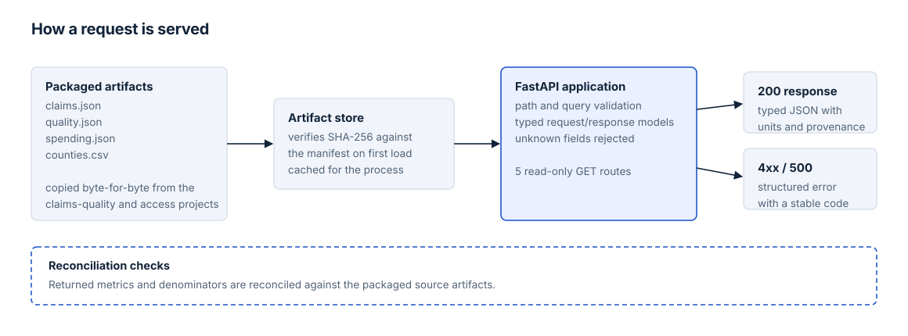

# Healthcare Analytics API

Read-only FastAPI service that lets other applications use the results of the claims and primary-care access analyses without reading each project's files. It serves a fixed snapshot and recalculates nothing.

Every metric comes back with its unit, denominator, source period and source version. Totals are returned in integer cents and missing values as `null`, not zero. Invalid inputs return errors in one JSON format with documented codes. Tests check every metric and denominator the service returns against the packaged source files, and cover response shapes, bad input, missing or altered data files, and repeat runs.



| GET endpoint | Returns |
|---|---|
| `/health` | Service status and a check that the packaged data loaded correctly |
| `/quality/summary` | Defect-evaluation results by category from the synthetic claims analysis |
| `/spending/summary` | Baseline spending and utilization, with the join-error comparison |
| `/access/counties` | All 14 Massachusetts counties, sorted by FIPS; optional `selection` filter |
| `/access/counties/{county_fips}` | One county |

## Run it

Requires Python 3.11+.

```sh
python3 -m venv .venv
.venv/bin/python -m pip install -r requirements-lock.txt
.venv/bin/python -m pip install --no-deps .
.venv/bin/python -m pytest -q
.venv/bin/python -m uvicorn healthcare_api.app:app --host 127.0.0.1 --port 8000
```

Then open [Swagger UI](http://127.0.0.1:8000/docs) or the [OpenAPI JSON](http://127.0.0.1:8000/openapi.json). There is no authentication, so the service runs on localhost only.

```sh
curl http://127.0.0.1:8000/health
curl http://127.0.0.1:8000/quality/summary
curl http://127.0.0.1:8000/spending/summary
curl 'http://127.0.0.1:8000/access/counties?selection=baseline'
curl http://127.0.0.1:8000/access/counties/25011
```

Recorded response for Franklin County, trimmed to one metric:

```json
{
  "provenance": {
    "project": "ma-primary-care-access",
    "project_version": "0.1.0",
    "commit": "67bd860b69ac33384dd238647c83169d250f8d5b",
    "artifact_version": "1",
    "source_period": "ACS 2019-2023; physician counts 2023",
    "limitation": "County screening indicators do not establish unmet need or an optimal clinic location."
  },
  "county": {
    "county_fips": "25011",
    "county": "Franklin",
    "baseline_selected": true,
    "capacity_stable": true,
    "metrics": [
      {
        "name": "population",
        "value": 70922.0,
        "unit": "people",
        "basis": "ACS total population",
        "denominator": null,
        "source_period": "ACS 2019-2023"
      }
    ]
  }
}
```

Counties not in the dataset return `404`:

```json
{ "error": { "code": "resource_unavailable", "message": "County is unavailable in this dataset." } }
```

More recorded requests and responses are in [`docs/examples.json`](docs/examples.json). Request and error behavior is in [contracts and errors](docs/CONTRACTS.md).

## Limitations

The API serves a fixed snapshot of the two projects' outputs. It runs locally as a demonstration and is not a production service. The claims data are synthetic, and the access indicators are historical public figures. Every limitation of the source projects also applies here.

## Reference

- [Claims Quality & Reconciliation](https://github.com/yashwanth-kanajam/healthcare-claims-quality): `claims.json`, `quality.json` and `spending.json`
- [Massachusetts Primary Care Access Planning](https://github.com/yashwanth-kanajam/ma-primary-care-access): `counties.csv`

[Metric definitions](docs/METRICS.md) · [Validation](docs/VERIFICATION.md) · [Provenance](docs/PROVENANCE.md)
